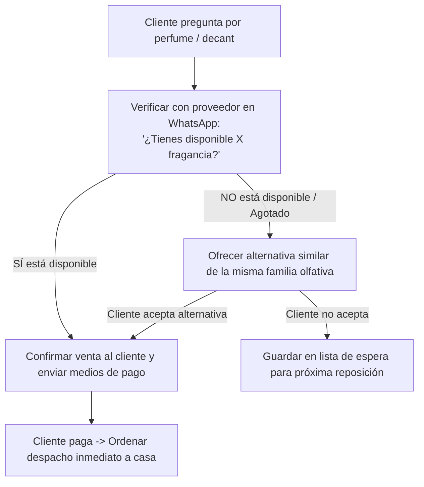

# 30-inventario-decants — Manual del Área

<!-- Archivo espejo para compatibilidad con Claude / Claude Code. El archivo primario de Antigravity / Gemini vive en cerebro/30-inventario-decants/GEMINI.md -->

Este es el manual operativo de **Inventario y Decants** de Perfumes SAAD. Aquí vive la estrategia de abastecimiento, el modelo de inventario contra-pedido (Dropshipping), los márgenes y el control de disponibilidad de producto.

---

## Modelo de Operación: Dropshipping Local (Contra-pedido)

A diferencia de un modelo tradicional de tienda que inmoviliza millones de pesos en cajas cerradas en una bodega, **Perfumes SAAD opera bajo un modelo de Dropshipping ágil con proveedor local en Barranquilla**:

- **Cero capital atrapado:** No se compran botellas de $300.000 COP a la espera de que alguien las pida.
- **Cero mermas de fraccionamiento:** El proveedor entrega los **decants de 10 ml ya envasados y sellados**, eliminando el desperdicio por jeringas, evaporación, roturas de botellas abiertas o compra masiva de atomizadores vacíos.
- **Control de calidad y marca:** El producto llega a la casa del dueño, quien inspecciona la presentación, coloca la bolsa de lujo de Perfumes SAAD (para botellas enteras) o el estuche rígido con base de fomi (para decants de 10 ml), y garantiza la entrega el mismo día.

---

## Reglas de Márgenes y Precios de Venta

Para mantener el negocio rentable y con números sanos, se aplican estas reglas de utilidad en cada pedido:

### 1. Botellas grandes (Frascos enteros)
- **Margen objetivo:** **+$70.000 COP** de utilidad bruta por frasco.
- **Rango mínimo aceptable:** Entre **$50.000 y $70.000 COP** de ganancia por unidad.
- Si el costo del proveedor sube, el precio de venta en catálogo se ajusta para proteger este margen neto.

### 2. Decants (10 ml)
- **Costo aproximado del proveedor:** Entre **$20.000 y $25.000 COP** (según la gama y exclusividad de la fragancia original).
- **Precio de venta al público:** Alrededor de **$40.000 COP** (variable según gama).
- **Margen de ganancia:** Entre **$15.000 y $20.000 COP** por cada decant vendido (~40% a 50% de margen).

### 3. Logística del Proveedor (Costo oculto)
- Cada envío del proveedor a la casa del dueño cuesta **$10.000 COP** de domicilio en Barranquilla.
- *Regla operativa:* Agrupar pedidos cuando sea posible o asegurar que el margen de la venta cubra este flete sin erosionar la ganancia de $50k-$70k.

---

## Protocolo de Consulta y Disponibilidad

Como el inventario no está en bodega propia sino en la bodega del distribuidor, el flujo de confirmación es estricto:

1. **Jamás cobrar sin confirmar stock:** Antes de enviar la plantilla de medios de pago al cliente, se consulta en tiempo real con el proveedor por chat si la botella o decant está disponible para despacho inmediato.
2. **Protocolo ante producto agotado:**
   - No decir simplemente "no hay".
   - Ofrecer de inmediato una alternativa de la misma familia olfativa o un aroma de perfil similar (ej. si buscan *Afnan 9PM*, sugerir *Lattafa Ramz Silver* o *Ultra Male*).

---

## Tareas del Área

### Tarea 1: Verificación de stock con el proveedor
- **Frecuencia:** Por cada consulta de compra en WhatsApp.
- **Acción:** Enviar mensaje directo al proveedor para confirmar existencias de la referencia y presentación (frasco o 10 ml).

### Tarea 2: Recepción e inspección en casa
- **Frecuencia:** Cada vez que el domiciliario del proveedor llega con un pedido.
- **Acción:**
  - Botellas: Verificar que la caja original no esté golpeada y que el celofán protector esté intacto.
  - Decants: Verificar que el atomizador esté bien ajustado, sin fugas y con líquido limpio y cristalino.

### Tarea 3: Embalaje final con marca propia
- Colocar la botella en la bolsa de **Perfumes SAAD** o el decant en el **estuche con fomi amortiguador**.
- Notificar a `20-pedidos-despachos` que el paquete está listo para salir a ruta.

---

## Qué recibe de otras áreas

- **De `10-ventas-catalogo`:** Solicitud de confirmación de perfume/decant para cotizar.
- **De `40-proveedores-compras`:** Contactos de respaldo, listas de precios actualizadas y acuerdos con distribuidores mayoristas.

---

## Qué entrega a otras áreas

- **A `10-ventas-catalogo`:** Confirmación de si hay stock para cerrar la venta o la recomendación de perfumes alternativos si está agotado.
- **A `20-pedidos-despachos`:** El producto inspeccionado y empacado para entrega el mismo día.
- **A `60-finanzas-conciliacion`:** El costo exacto del producto y los $10.000 del flete del proveedor para el cálculo de la utilidad neta en el panel.

---

## Dolores Principales y Oportunidades

1. **Riesgo de quiebre de stock ajeno:** El principal dolor del Dropshipping es que el proveedor se quede sin inventario de un perfume viral o muy solicitado, perdiendo la venta.
   - *Oportunidad:* Contar con un segundo proveedor de respaldo en Barranquilla o Bogotá para cruzar stock cuando el principal agote.
2. **Impacto del flete de $10.000:** Cuando se vende un solo decant de $40.000 (ganancia bruta $18.000), pagar $10.000 de flete del proveedor se come más de la mitad de la utilidad.
   - *Estrategia:* Fomentar combos de 2 o 3 decants o incentivar la compra de botellas completas para diluir el flete.
3. **Paso futuro a stock propio de alta rotación:** A medida que la pauta aumente las ventas, tener 2 o 3 unidades propias de los 5 perfumes más vendidos para no pagar flete de proveedor por cada venta individual.

---

## PENDIENTE (de esta área)

- [ ] Identificar un segundo proveedor de confianza en Barranquilla para respaldo de stock.
- [ ] Definir catálogo de promociones "Combos de 2 y 3 Decants" para proteger el margen frente al flete del proveedor.
- [ ] Lista de los 5 perfumes con mayor frecuencia de agotado en el proveedor.
