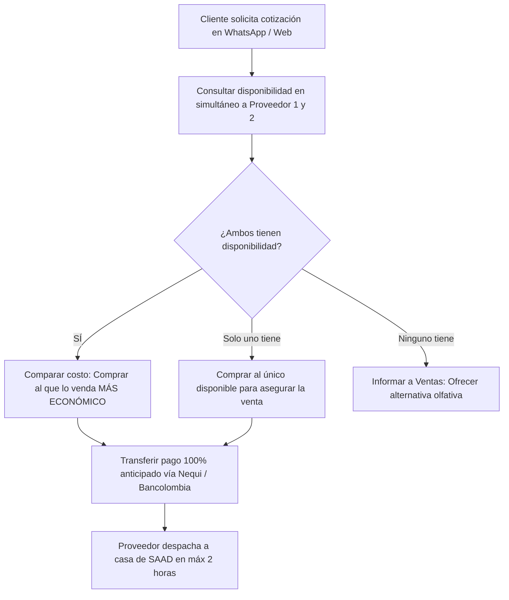

# 40-proveedores-compras — Manual del Área

Este es el manual operativo de **Proveedores y Compras** de Perfumes SAAD. Aquí se documenta la red de abastecimiento, los acuerdos comerciales, las condiciones de pago, los tiempos de respuesta de los distribuidores mayoristas y la gestión de empaques e insumos.

---

## Red de Abastecimiento Principal

Perfumes SAAD opera con **2 proveedores mayoristas estratégicos** ubicados localmente en **Barranquilla**:

| Proveedor | Ubicación | Líneas que Maneja | Presentaciones |
| :--- | :--- | :--- | :--- |
| **Distribuidor 1** | Barranquilla | Diseñador, Árabes y Nicho | Botellas completas y Decants (10 ml) listos |
| **Distribuidor 2** | Barranquilla | Diseñador, Árabes y Nicho | Botellas completas y Decants (10 ml) listos |

Ambos distribuidores son integrales y suministran el 100% del portafolio comercializado. Al tener dos opciones completas, la empresa no depende de una sola fuente y puede optimizar costos y disponibilidad en cada operación.

---

## Estrategia de Compra: Arbitraje de Precios por Chat

La dinámica de abastecimiento se ejecuta **contra-pedido** (dropshipping local ágil):

1. **Consulta producto a producto:** No se usan listas de precios estáticas (los precios mayoristas oscilan frecuentemente con el dólar y la demanda). Se consulta directamente por chat de WhatsApp al cotizar.
2. **Criterio de selección (Arbitraje de Margen):** Siempre se le compra al proveedor que tenga el precio unitario más económico, asegurando que la ganancia neta se mantenga en el rango objetivo ($50.000 - $70.000 COP en botellas completas y $15.000 - $20.000 COP en decants).

---

## Condiciones Comerciales y Pagos

- **Condición de pago:** **100% por adelantado** (pago anticipado). Los distribuidores no entregan a crédito ni contra entrega en este modelo.
- **Canales de transferencia:**
  - **Nequi**
  - **Bancolombia** (cuenta de ahorros)
- **Costo de envío del proveedor a SAAD:** **$10.000 COP** por cada carrera de domicilio local hacia la casa del dueño.

---

## Horarios de Despacho y Tiempos de Entrega

La velocidad del proveedor es crítica para garantizar la promesa de **"entrega el mismo día"** a los clientes de Barranquilla:

- **Horario de atención de los proveedores:**
  - **Lunes a Sábado:** 8:00 a.m. – 6:00 p.m.
  - **Domingos y Festivos:** 8:00 a.m. – 1:00 p.m.
- **Tiempo de entrega a casa de SAAD:** **Máximo 2 horas** después de confirmar la transferencia bancaria.

---

## Control de Calidad y Política de Garantías

Dado que el producto pasa primero por la casa del dueño antes de salir al cliente final, se realiza una inspección inmediata:

1. **Revisión obligatoria al recibir el domicilio:**
   - **Botellas:** Revisar celofán sin rasgaduras, caja sin esquinas hundidas o golpes por transporte.
   - **Decants:** Revisar rosca bien apretada, ausencia de fugas en la boquilla y etiqueta/frasco limpio.
2. **Política de garantía con los proveedores:**
   - Si un producto llega golpeado, derramado o con la referencia equivocada, **los proveedores responden y realizan cambio inmediato** sin trabas.
   - La novedad debe reportarse en el mismo momento de la recepción por WhatsApp con foto/video de evidencia.

---

## Proveedor de Empaques e Insumos

Para mantener la identidad de marca de Perfumes SAAD, el packaging se gestiona con un proveedor independiente:

- **Proveedor:** Fabricante local en **Barranquilla**.
- **Insumos adquiridos:**
  - Bolsas de lujo contramarcadas con el branding de **Perfumes SAAD** (para botellas enteras).
  - Cajas de cartón rígido con molde de espuma a medida (para decants de 10 ml).
- **Modelo de compra:** Lotes de **50 unidades** que se mantienen como inventario físico de empaque en casa.

---

## Tareas del Área

### Tarea 1: Consulta y arbitraje de precios
- **Frecuencia:** En cada cotización de venta.
- **Acción:** Escribir a ambos proveedores para validar stock y costo exacto antes de cerrar la venta con el cliente.

### Tarea 2: Emisión de pagos de compra
- **Frecuencia:** Tras la confirmación del pago del cliente (o aprobación de crédito).
- **Acción:** Transferir vía Bancolombia o Nequi el valor del producto + los $10.000 de flete local. Enviar comprobante por WhatsApp solicitando despacho inmediato a casa.

### Tarea 3: Inspección y activación de garantía
- **Frecuencia:** Con cada entrega que llega del proveedor.
- **Acción:** Validar estado físico de la pieza. Si hay defectos, solicitar cambio de inmediato antes de que el cliente final lo note.

### Tarea 4: Control de stock de packaging
- **Frecuencia:** Semanal.
- **Acción:** Contar bolsas y cajas restantes en casa. Cuando queden menos de 10 unidades, ordenar un nuevo lote de 50 al proveedor de empaques.

---

## Qué recibe de otras áreas

- **De `10-ventas-catalogo`:** Fragancias solicitadas por clientes para cotizar costo y confirmar disponibilidad.
- **De `60-finanzas-conciliacion`:** Fondos disponibles en cuentas Nequi/Bancolombia para realizar los pagos anticipados a proveedores.

---

## Qué entrega a otras áreas

- **A `10-ventas-catalogo`:** Costo base confirmado y luz verde de stock para cotizar al cliente.
- **A `30-inventario-decants`:** El producto físico recibido del mayorista para su inspección, embalaje con marca propia y alistamiento.
- **A `60-finanzas-conciliacion`:** Comprobantes de pago a distribuidores y fletes locales de $10.000 para cuadrar el costo de venta (COGS) en el sistema.

---

## Dolores Principales y Oportunidades

1. **Dependencia de la consulta manual:** Al no tener un catálogo API o feed automático de stock, cada consulta exige esperar la respuesta por chat del mayorista (aunque dentro de su horario responden rápido).
2. **Margen en decants individuales:** Si se pide un solo decant con flete de $10.000, el costo de transporte encarece la compra.
   - *Oportunidad:* Agrupar pedidos del mismo proveedor cuando entren varios en la misma franja de la mañana o de la tarde.
3. **Poder de negociación a mayor escala:** Al mantener compras continuas con solo 2 proveedores, se puede negociar a futuro una tarifa preferencial de flete o descuentos por volumen semanal.
