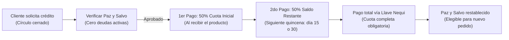

# 50-cartera-cobranza — Manual del Área

Este es el manual operativo de **Cartera y Cobranza** de Perfumes SAAD. Aquí vive la política de crédito, los criterios de otorgamiento, el esquema de cobro quincenal (50/50), la gestión de recordatorios automatizados y el protocolo estricto ante morosidad.

---

## Filosofía del Crédito en Perfumes SAAD

El crédito (fiado) **no es un canal de captación masiva ni abierto al público general**. Es un beneficio exclusivo reservado únicamente para un círculo cerrado de extrema confianza:
- Amigos cercanos
- Familiares
- Compañeros de trabajo de trato diario

> [!WARNING]
> **Riesgo Financiero:** Como al proveedor mayorista se le paga el 100% de contado y por adelantado, cada venta a crédito compromete capital de trabajo del negocio o dinero personal del dueño. Por ello, las reglas de otorgamiento y cobro son inflexibles.

---

## Modelo de Pago: Esquema 50/50 Quincenal

Todo pedido a crédito opera bajo la fórmula estricta de dos cuotas:

1. **Cuota inicial (50%):** Se cobra en el mismo momento en que la persona recibe el producto. Este abono amortiza el desembolso inicial pagado al distribuidor.
2. **Saldo final (50% restante):** Se cancela en la **siguiente quincena** más próxima (días 15 o 30 del mes).
3. **Exigencia de pago total:** No se aceptan micro-abonos fragmentados ni pagos a cuentagotas; el cliente debe liquidar la cuota completa restante en la fecha acordada.

---

## Reglas de Cupo y Restricciones

1. **Límite por persona:** Máximo **1 perfume a crédito a la vez**.
2. **Regla de Paz y Salvo Absoluto:** Si un cliente tiene un saldo pendiente de un pedido anterior, **está terminantemente prohibido autorizarle un segundo pedido a crédito**, sin importar la cercanía personal o familiar. Primero debe cancelar el 100% del saldo anterior.
3. **Techo global de cartera activa:** Mantener un tope máximo acumulado en la calle (máximo \$600.000 – \$800.000 COP totales entre todos los deudores simultáneos) para evitar asfixiar la liquidez del negocio.

---

## Calendario de Cobro y Automatización

Los cobros no se dejan a la memoria ni se improvisan. Se ejecutan con disciplina según el calendario de quincenas:

- **Días de cobro oficial:** **15 y 30** de cada mes.
- **Herramienta operativa:** Módulo de Cartera (`/cartera`) y Pantalla de Cobro Rápido (`/cobrar`) en el panel administrativo.
- **Canal de recepción del pago:** Exclusivamente vía **Llave Nequi** (número celular registrado).

### Mensaje Automatizado de Cobro por WhatsApp
El sistema genera el enlace directo a WhatsApp (`https://wa.me/...`) con el siguiente formato predeterminado:

> *"Hola [Nombre], te recordamos que tenés un saldo pendiente de $[Monto] en Perfumes SAAD, correspondiente a [N] pedido(s) que [vence hoy / vence en X días / venció hace X días]. Cuando puedas te lo agradecemos. ¡Gracias!"*

---

## Política de Mora y Gestión de Incumplimientos

1. **Período de tolerancia:** Se otorga un margen de gracia de máximo **5 días calendario** posteriores a la fecha de vencimiento (15 o 30) para regularizar el pago.
2. **Consecuencia ante incumplimiento:**
   - Si la persona supera los 5 días de tolerancia, evade los mensajes o requiere insistencia excesiva para cancelar:
     - **Queda bloqueada permanentemente para crédito** en el sistema (`setCreditBlock`).
     - No se le vuelve a fiar jamás.
     - Cualquier compra futura deberá ser pagada **100% de contado por adelantado**.

---

## Separación de Fondos: Plata Personal vs Utilidad del Negocio

Cuando la cuota inicial del 50% no cubre el 100% del costo del proveedor mayorista, la diferencia sale temporalmente del capital de trabajo o del bolsillo del dueño:

- **Aporte del Socio (Préstamo temporal):** Dinero personal inyectado por Saad para pagar al mayorista.
- **Reembolso prioritario:** Al entrar el segundo 50% vía Llave Nequi en la quincena:
  1. Primero se repone el capital personal financiado.
  2. El remanente pasa a registrarse como utilidad líquida disponible del negocio en `60-finanzas-conciliacion`.

---

## Tareas del Área

### Tarea 1: Verificación de cupo previo a la venta
- **Frecuencia:** Cada vez que un conocido solicita comprar a crédito en `10-ventas-catalogo`.
- **Acción:** Consultar en `/cartera` si el cliente tiene saldo activo. Si debe algo, rechazar el crédito amablemente hasta que se ponga a paz y salvo.

### Tarea 2: Registro del 50% inicial
- **Frecuencia:** Al entregar el producto.
- **Acción:** Ingresar al pedido en el panel y registrar el abono del 50% con fecha y método de pago (Llave Nequi / transferencia).

### Tarea 3: Envío de recordatorios quincenales
- **Frecuencia:** Los días 15 y 30 de cada mes (y seguimiento a los 5 días de tolerancia).
- **Acción:** Abrir `/cobrar`, filtrar los clientes por vencer o vencidos, y disparar los recordatorios directos por WhatsApp con un solo clic.

### Tarea 4: Liquidación y bloqueo de morosos
- **Frecuencia:** Tras cumplirse los 5 días de gracia.
- **Acción:** Si no pagó, activar la bandera de bloqueo de crédito en la ficha del cliente en el panel.

---

## Qué recibe de otras áreas

- **De `10-ventas-catalogo`:** Órdenes cerradas bajo la modalidad de crédito para clientes autorizados.
- **De `20-pedidos-despachos`:** Confirmación de que el cliente recibió el producto y pagó su cuota inicial del 50%.

---

## Qué entrega a otras áreas

- **A `10-ventas-catalogo`:** Lista de clientes bloqueados para crédito por morosidad previa.
- **A `60-finanzas-conciliacion`:** Registro de cobros efectivamente recaudados por Llave Nequi para conciliar saldos y reembolsar aportes de capital del dueño.

---

## Dolores Principales y Oportunidades

1. **Cobrar a personas cercanas:** La cobranza a amigos y familiares suele generar incomodidad o fricción social.
   - *Solución SAAD:* Apoyarse en la automatización del sistema y el mensaje institucional del panel para que el cobro se perciba como un proceso administrativo estándar de la empresa y no como un reclamo personal.
2. **Financiamiento con dinero propio:** El desfase entre el pago anticipado al proveedor y la quincena del cliente puede drenar la caja.
   - *Solución:* Mantener el tope de 1 perfume a la vez por persona y exigir sin excepción el 50% en la entrega.
