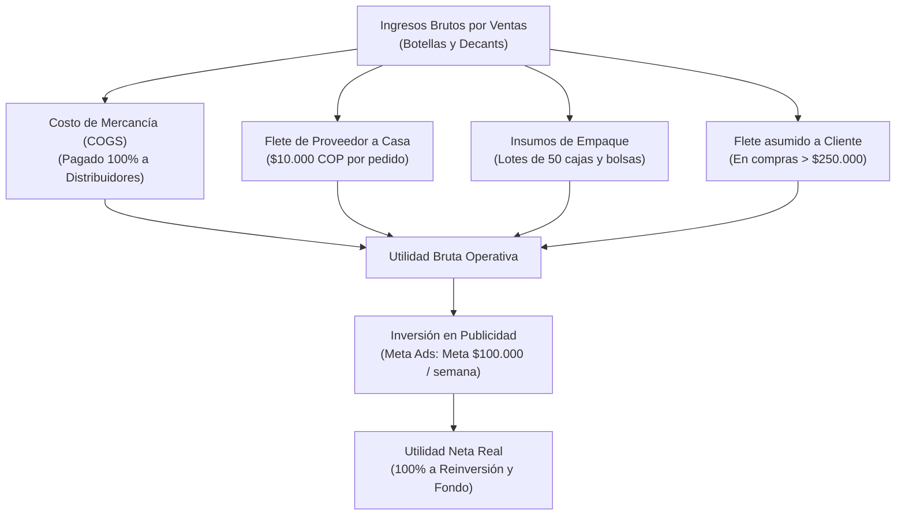

# 60-finanzas-conciliacion — Manual del Área

Este es el manual operativo de **Finanzas y Conciliación** de Perfumes SAAD. Aquí se documenta el flujo de caja, las cuentas bancarias de recaudo, la estructura de costos fijos y variables, el principio de utilidad realizada en caja, la conciliación semanal vía CSV y la política de reinversión del capital.

---

## Filosofía Financiera de Perfumes SAAD

Perfumes SAAD opera bajo un modelo de **estructura liviana y alta rentabilidad sobre capital**:
- **Cero costos fijos estructurales:** No hay pago de arriendos comerciales, bodegas ni nóminas fijas. La operación es 100% digital y administrada por el fundador.
- **Utilidad sobre recaudo real (Caja):** La empresa no reconoce utilidades en papel. Si un cliente compra a crédito (esquema 50/50), la utilidad se registra como **$0** hasta que los pagos recibidos hayan cubierto el 100% del costo del producto con el proveedor mayorista.
- **Reinversión total para crecimiento:** El 100% de los beneficios generados en esta etapa se reinvierte en comprar inventario de decants de muestra, insumos de marca propia y pauta digital.

---

## Cuentas Bancarias y Canales de Recaudo

| Canal | Tipo de Cuenta | Uso Principal | Método de Verificación |
| :--- | :--- | :--- | :--- |
| **Nequi Negocios** | Vinculada a Nequi personal | Recaudo de ventas web, catálogo y cuotas de crédito (Llave Nequi) | Notificación push instantánea en celular + reporte CSV de movimientos |
| **Bancolombia** | Cuenta de Ahorros personal | Transferencias de clientes bancarizados o pedidos de mayor volumen | Notificación de abono en app Bancolombia |

> [!IMPORTANT]
> **Regla de Cero Despachos a Ciegas:** Jamás se ordena un perfume al proveedor basándose únicamente en la captura de pantalla o comprobante que envía el cliente por WhatsApp. La orden solo se activa cuando llega la **notificación push oficial del banco** confirmando que el dinero ingresó a la cuenta.

---

## Estructura de Costos y Gastos



### 1. Costos Variables de Venta
- **Costo del perfume / decant:** Pagado de contado por transferencia bancaria a los distribuidores de Barranquilla.
- **Flete de abastecimiento:** **$10.000 COP** fijos por cada carrera de domicilio desde el distribuidor a la casa de SAAD.
- **Flete nacional/local bonificado:** Asumido por la empresa en órdenes superiores a **$250.000 COP**.
- **Empaque:** Cajas rígidas con espuma a medida y bolsas de lujo adquiridas en lotes de 50 unidades.

### 2. Gastos Fijos y de Mercadeo
- **Gastos fijos:** **$0 COP** (cero arriendo, cero servicios públicos comerciales, cero nómina).
- **Publicidad digital (Meta Ads / Instagram):**
  - Campaña piloto ejecutada: \$32.000 COP.
  - **Presupuesto objetivo proyectado:** **$100.000 COP semanales** (~$400.000 COP mensuales) para traccionar tráfico frío hacia WhatsApp y web.

---

## Reconocimiento de Utilidad: Dinero Personal vs Utilidad del Negocio

En el módulo de **Pedidos** y **Finanzas**, cada venta se evalúa bajo el principio de recuperación de costos:

```
[Dinero Recaudado del Cliente] - [Costo Total del Producto + Flete Proveedor] = Utilidad Realizada
```

### El Caso del Crédito (Aporte del Socio)
Cuando un cliente da el 50% de cuota inicial y el valor recibido no alcanza a cubrir el costo mayorista:
- **Aporte Temporal de Saad:** El fundador pone la diferencia de su dinero personal para pagarle de inmediato al distribuidor.
- **Estado en Panel:** La utilidad realizada permanece en **$0** y se registra el saldo de capital propio pendiente de reembolso.
- **Liquidación en Quincena:** Cuando el cliente paga el saldo final el 15 o 30:
  1. Se reembolsa a Saad el capital personal prestado.
  2. La diferencia restante se computa como ganancia neta líquida del negocio.

---

## Rutina Semanal de Conciliación Bancaria

Cada fin de semana (o los días lunes), se realiza el cuadre formal de caja en `/utilidad`:

1. **Descarga de extracto:** Ingresar al portal de **Nequi Negocios** y descargar el archivo de movimientos en formato **CSV**.
2. **Carga en el sistema:** Entrar a la sección de Conciliación en el panel administrativo y subir el archivo CSV.
3. **Punteo automático:** El sistema cruza los valores, referencias y fechas del CSV contra los pedidos registrados en la base de datos.
4. **Validación de inconsistencias:** Verificar que no haya diferencias entre el dinero registrado en el banco y los pedidos marcados como confirmados/pagados.

---

## Política de Reinversión y Fondo de Reserva

1. **Destino de utilidades actual:** No se realizan retiros para gastos personales del fundador. Todas las ganancias se quedan en la cuenta bancaria para:
   - Financiar compras sin depender de dinero del bolsillo personal.
   - Adquirir decants de 10 ml para muestras olfativas en asesorías.
   - Pagar la pauta semanal de $100.000 COP en Meta Ads.
2. **Meta del Fondo de Reserva (Colchón de Caja):**
   - **Objetivo financiero:** Consolidar un saldo mínimo intocable de **$500.000 a $1.000.000 COP** en la cuenta de Nequi.
   - **Función del fondo:** Absorber pedidos imprevistos, compras de contado de alta gama y lotes de empaque sin descapitalizar la operación diaria.

---

## Tareas del Área

### Tarea 1: Verificación en tiempo real de abonos
- **Frecuencia:** En cada venta o cuota recibida.
- **Acción:** Corroborar la notificación push del banco en el celular antes de autorizar el despacho o compra con proveedor.

### Tarea 2: Conciliación semanal con CSV
- **Frecuencia:** Semanal.
- **Acción:** Exportar movimientos de Nequi Negocios, cargarlos en `/utilidad` y auditar que todos los pedidos tengan su ingreso bancario conciliado.

### Tarea 3: Monitoreo de utilidad neta y métricas
- **Frecuencia:** Semanal / Mensual.
- **Acción:** Revisar el P&L en el panel: Ventas brutas, costo de mercancía, fletes asumidos, gasto de pauta publicitaria y margen neto real.

### Tarea 4: Provisión del Fondo de Reserva
- **Frecuencia:** Quincenal (tras recaudar cartera).
- **Acción:** Retener la utilidad en la cuenta hasta alcanzar el colchón de seguridad de $500.000 - $1.000.000 COP.

---

## Qué recibe de otras áreas

- **De `20-pedidos-despachos`:** Notificación de pedidos confirmados y fletes locales/nacionales a pagar.
- **De `40-proveedores-compras`:** Comprobantes de pago a mayoristas y fletes de abastecimiento de $10.000 para imputar al costo del producto.
- **De `50-cartera-cobranza`:** Recaudos quincenales por Llave Nequi para liquidar cuotas pendientes y reembolsar capital.

---

## Qué entrega a otras áreas

- **A `40-proveedores-compras`:** Liquidez y saldo bancario disponible en Nequi/Bancolombia para pagar mercancía anticipada.
- **A `70-marketing-crm`:** Presupuesto semanal asignado para pauta publicitaria en Meta Ads ($100.000 COP).

---

## Dolores Principales y Oportunidades

1. **Mezcla visual de cuentas:** Al caer el dinero de Nequi Negocios a la misma cuenta personal, se requiere disciplina para no usar el dinero del negocio en compras del hogar.
   - *Solución:* Mantener la meta del colchón de caja y monitorear el indicador de utilidad acumulada en el panel.
2. **Control de aportes personales:** Visualizar en el panel con total transparencia qué pedidos fueron cubiertos con dinero del bolsillo de Saad para garantizar su devolución exacta.
3. **Escalar la pauta publicitaria:** Con una estructura de costos fijos de $0, cada peso invertido en pauta rentable ($100.000 semanal) acelera el volumen de pedidos sin incrementar gastos operativos.
