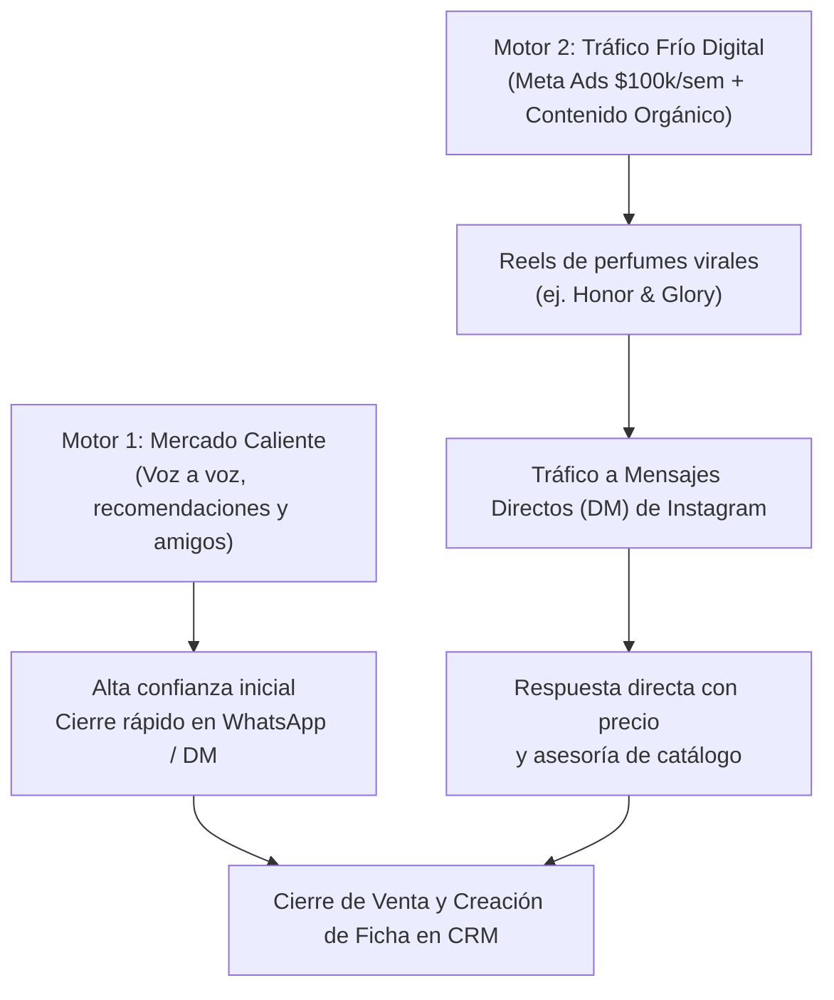
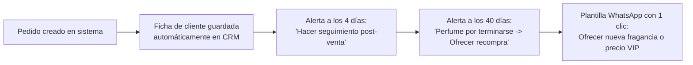

# 70-marketing-crm — Manual del Área

Este es el manual operativo de **Marketing y CRM** de Perfumes SAAD. Aquí se documentan las estrategias de adquisición de clientes, la gestión de pauta en Meta Ads, el protocolo de atención por Mensajes Directos de Instagram, el seguimiento post-venta y la fidelización de clientes recurrentes.

---

## Estrategia de Adquisición de Clientes

Perfumes SAAD combina dos motores de crecimiento:

1. **Voz a voz y recomendaciones (Base sólida):** Ha sido el motor histórico del negocio. Clientes satisfechos y amigos de confianza que refieren nuevos compradores.
2. **Instagram y Meta Ads (Motor de escala):** Anuncios en video (Reels) promocionando fragancias de alto impacto visual y sensorial (como *Lattafa Bade'e Al Oud Honor & Glory*) dirigidos directamente a los **Mensajes Directos (DM) de Instagram**.

---

## Protocolo de Atención y Cierre en Instagram DM

A diferencia de modelos con fricción que obligan al cliente a saltar de aplicación o a registrarse en páginas complejas, Perfumes SAAD prioriza la **velocidad y la transparencia**:

1. **Respuesta directa con precio:** Cuando un prospecto escribe *"hola, precio"* o pregunta por una fragancia, se le entrega de inmediato el valor claro de la botella y de la presentación en decant (10 ml), sin rodeos ni mensajes evasivos.
2. **Cierre dentro de Instagram:** La venta se busca cerrar dentro del mismo chat de Instagram DM donde el cliente inició la conversación.
3. **Paso a WhatsApp (Opcional/Logístico):** Se solicita el número de WhatsApp únicamente para coordinar la entrega o cuando el cliente requiere fotos detalladas del empaque antes del despacho.

---

## Estrategia de Contenido Orgánico en Redes

La cuenta de Instagram de Perfumes SAAD se nutre de 4 pilares fundamentales de contenido:

| Pilar de Contenido | Formato | Objetivo |
| :--- | :--- | :--- |
| **Reseñas y notas olfativas** | Videos cortos / Reels | Educar al cliente sobre duración, proyección y ocasiones de uso. |
| **Catálogo y estética** | Fotografías cuidadas de producto | Mostrar la elegancia y originalidad de los frascos. |
| **Prueba social (Entregas)** | Historias de pedidos empacados y rutas | Demostrar que el negocio despacha todos los días en Barranquilla. |
| **Testimonios de clientes** | Capturas de chats con clientes felices | Romper el escepticismo de compradores primerizos. |

---

## Estrategia de Pauta en Meta Ads

- **Presupuesto objetivo:** **$100.000 COP semanales** (~$400.000 COP mensuales).
- **Formato ganador validado:** Video Reel mostrando perfumes gourmand, dulces o amaderados con frascos impactantes (caso de éxito: *Bade'e Al Oud Honor & Glory*).
- **Destino del anuncio:** Botón con llamado a la acción dirigido a **Enviar Mensaje por Instagram**.
- **Segmentación:** Hombres y mujeres en Barranquilla y principales ciudades del país interesados en perfumería árabe, lujo accesible y fragancias nicho.

---

## Protocolo Post-Venta y Fidelización (Recompra)

En perfumería, el cliente que ya compró una vez tiene una probabilidad altísima de volver a comprar en los próximos 30 a 60 días si el aroma le generó cumplidos:

1. **Mensaje de seguimiento post-venta (Día 3 a 4 tras la entrega):**
   - Escribirle al cliente para preguntarle: *"Hola [Nombre], ¿cómo te fue con el perfume? ¿Qué tal la fijación y los cumplidos que te han hecho?"*
   - Este mensaje valida la satisfacción, recoge testimonios espontáneos y refuerza la relación.
2. **Beneficio VIP para clientes recurrentes:**
   - A los clientes que repiten compra (como los que compran 2 o más fragancias en el mismo mes), se les premia con un **precio especial exclusivo** o condiciones preferenciales.

---

## Automatizaciones Clave Requeridas para el CRM (`/crm`)

El sistema CRM debe quitarle carga mental al fundador y hacer el negocio más fácil y automático:

1. **Guardado automático de contactos:** Cada vez que se crea un pedido en la tienda o panel admin, el cliente debe quedar archivado en el CRM con su nombre, teléfono, ciudad y fragancias compradas.
2. **Alerta de seguimiento post-venta:** Notificación en el dashboard a los 4 días de despachado el pedido para enviar el mensaje de satisfacción.
3. **Ciclo de recompra inteligente (30-45 días):** Recordatorio automático en el CRM avisando: *"El perfume de [Nombre] debe estar terminándose. Escríbele para ofrecerle una nueva referencia con precio especial VIP"*.

---

## Tareas del Área

### Tarea 1: Atención de prospectos en Instagram DM
- **Frecuencia:** Diaria / Continua.
- **Acción:** Responder cotizaciones con precios claros de botella y decant, cerrando la orden dentro del chat.

### Tarea 2: Publicación de contenido y prueba social
- **Frecuencia:** Diaria en Historias; 2-3 Reels por semana.
- **Acción:** Subir videos de despachos, fotos de botellas y reseñas rápidas de aromas en tendencia.

### Tarea 3: Ejecución y optimización de Meta Ads
- **Frecuencia:** Semanal.
- **Acción:** Mantener activa la pauta de $100.000 COP semanal hacia Instagram DM con los videos de mayor tracción.

### Tarea 4: Seguimiento post-venta y recompra en el CRM
- **Frecuencia:** Semanal.
- **Acción:** Revisar las alertas del CRM para escribirle a compradores recientes (satisfacción) y a compradores de hace 40 días (recompra).

---

## Qué recibe de otras áreas

- **De `20-pedidos-despachos`:** Notificación de pedidos entregados exitosamente para iniciar el conteo de días post-venta.
- **De `60-finanzas-conciliacion`:** Presupuesto de $100.000 semanales aprobado para campañas publicitarias.

---

## Qué entrega a otras áreas

- **A `10-ventas-catalogo`:** Prospectos calificados listos para cotizar y comprar.
- **A `20-pedidos-despachos`:** Nuevos pedidos cerrados para empaque y ruta el mismo día.

---

## Dolores Principales y Oportunidades

1. **Pérdida de contactos por falta de guardado:** Al no registrar los números en agenda telefónica, clientes que compraron antes se quedan en el historial antiguo de chats.
   - *Solución:* El CRM de Perfumes SAAD debe centralizar la base de datos de compradores de forma automática tras cada venta.
2. **Frecuencia de pauta consistente:** Invertir los \$100.000 semanales de manera constante para que el flujo de cotizaciones no dependa únicamente del voz a voz.
3. **Ventas cruzadas (Decant a Botella):** Quien compra un decant de \$40.000 COP y recibe cumplidos en su entorno es el prospecto perfecto para venderle la botella entera de \$250.000 COP al mes siguiente.
