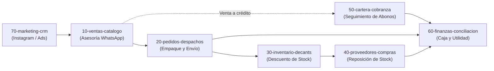

# Perfumes SAAD — Cerebro de la Empresa

Este archivo es el centro del cerebro operativo de **Perfumes SAAD**. Se lee cada vez que se abre esta carpeta o se consulta sobre la operación del negocio. Cada área de la empresa tiene su propia carpeta y su propio manual `GEMINI.md`; aquí está el plano general que las conecta a todas.

---

## Quiénes somos

- **Negocio:** Tienda de perfumería original (perfumería árabe, diseñador y nicho) y perfumería fraccionada (decants de 10 ml), con base en Barranquilla, Colombia.
- **Canales de venta:** Catálogo web digital (`catalogo-saad.vercel.app` / `perfumes-saad.vercel.app`) y WhatsApp de ventas (`+57 310 231 8786`).
- **Modelo de cobro:** No hay pasarela de pago online automática. El cliente arma su pedido en la web o por chat, se genera el recibo y la confirmación se hace de forma manual por WhatsApp.
- **Medios de pago:** Nequi, Daviplata, Bancolombia (transferencia), efectivo contraentrega y datáfono/link cuando aplica.
- **Ventas a crédito:** Existe la modalidad de **Cartera (fiado)** con abonos parciales, límites de crédito por cliente y términos quincenales o mensuales.
- **Equipo:** Propietario/administrador (`esaadc19@gmail.com`), asesores de venta y domiciliarios/mensajería externa.

---

## Las Áreas del Negocio

| Carpeta | Qué vive ahí | Tareas repetitivas | De dónde salen los datos hoy |
|---|---|---|---|
| `10-ventas-catalogo` | Catálogo de fragancias, decants (10 ml) vs botellas completas, precios, ofertas y WhatsApp de ventas | Asesorar clientes por WhatsApp, recomendar perfumes según gustos/ocasión, cotizar decants y perfumes completos, enviar enlaces de catálogo | Catálogo web, lista de precios en el panel admin y memoria del administrador |
| `20-pedidos-despachos` | Registro de pedidos confirmados, empaque, domicilios en Barranquilla y envíos nacionales | Confirmar pagos/abonos iniciales, alistar empaque con protección, coordinar domiciliario local o generar guía nacional (Interrapidísimo/Envía/Coordinadora), enviar link de rastreo (`?track=...`) | Panel de Pedidos (`/pedidos`), chats de WhatsApp y comprobantes de transferencia |
| `30-inventario-decants` | Stock de botellas selladas, stock de decants (10 ml), insumos de fraccionamiento y mermas | Fraccionar botellas en decants de 10 ml con jeringas y atomizadores, etiquetar, registrar mermas (roturas, evaporación, muestras) | Panel de Inventario (`/productos`), sección de Decants en el Dashboard y bodega física |
| `40-proveedores-compras` | Red de distribuidores mayoristas de perfumes (2 proveedores en Barranquilla), arbitraje de costos, pagos anticipados (Nequi/Bancolombia), fletes de abastecimiento y empaques | Consultar disponibilidad y precios por WhatsApp ante cotizaciones, arbitraje de margen, pago anticipado, auditar garantías y reposición de empaques de 50 unidades | Chats de WhatsApp con mayoristas, transferencias bancarias y recibos de flete |
| `50-cartera-cobranza` | Clientes con crédito (círculo cerrado de confianza), esquema 50/50 quincenal (15 y 30), recaudos por Llave Nequi y control de morosidad | Validar paz y salvo previo, registrar 50% al entregar, enviar cobros automáticos por WhatsApp (`/cobrar`), aplicar 5 días de tolerancia y bloquear morosos | Módulo de Cartera (`/cartera`), pantalla de Cobro rápido (`/cobrar`) y Llave Nequi |
| `60-finanzas-conciliacion` | P&L de recaudo real en caja, Nequi Negocios, Bancolombia, conciliación semanal CSV, pauta ($100k/sem) y fondo de reserva ($500k-$1M) | Verificar notificaciones bancarias push, conciliar CSV semanalmente en `/utilidad`, calcular utilidad neta y separar préstamos personales del dueño | Módulo de Finanzas (`/utilidad`), reportes CSV de Nequi Negocios y alertas bancarias |
| `70-marketing-crm` | Mensajes de Instagram (Zernio CRM), fidelización, campañas de recompra y clientes VIP | Atender prospectos de Instagram DM, registrar interacciones en el CRM (`/crm`), planear lanzamientos de perfumes tendencia y promociones | CRM de Zernio, Instagram Direct y módulo de clientes |

---

## Cómo se pasa el trabajo entre áreas (Flujo Operativo)

1. **Contacto → Venta:** El cliente llega por Instagram o recomendación y pasa a `10-ventas-catalogo` para asesoría olfativa y cotización. *(70 → 10)*
2. **Confirmación → Pedido:** Cuando el cliente confirma el pedido y envía comprobante (o pide a crédito), pasa a `20-pedidos-despachos`. *(10 → 20)*
3. **Despacho → Inventario:** Al salir el producto, se descuenta de `30-inventario-decants` (si es decant, se asegura que haya frascos atomizadores y stock fraccionado). *(20 → 30)*
4. **Si es a crédito → Cartera:** Si el pedido queda con saldo pendiente, se abre ficha en `50-cartera-cobranza` con su fecha de cobro y límite de cupo. *(20 → 50)*
5. **Pago/Abono → Finanzas:** Todo ingreso por transferencia (Nequi, Bancolombia, etc.) o efectivo se puntea en `60-finanzas-conciliacion` para que la utilidad neta sea 100% real. *(20/50 → 60)*
6. **Stock bajo → Compras:** Cuando una presentación o decant llega a stock bajo, pasa a `40-proveedores-compras` para cotizar reposición con mayoristas. *(30 → 40)*

---

## Por dónde partir

1. **`10-ventas-catalogo`**: La puerta de entrada del dinero. Estandarizar la asesoría olfativa, los precios de decants (10 ml), las promociones vigentes y las respuestas rápidas de WhatsApp.
2. **`50-cartera-cobranza`**: El control del crédito. Definir límites máximos por cliente, días de cobro quincenales y mensajes de cobranza sin fricción.
3. **`60-finanzas-conciliacion`**: El control de la plata. Rutina de cuadre de Nequi y Bancolombia, registro de gastos fijos y lectura de utilidad real.
4. **`20-pedidos-despachos`**: Logística de empaque, mensajeros locales en Barranquilla y transportadoras nacionales.
5. **`30-inventario-decants`**: Fraccionamiento, cálculo de costo por mililitro y control de mermas/insumos.
6. **`40-proveedores-compras`**: Directorio de mayoristas confiables y costos de reposición.
7. **`70-marketing-crm`**: Protocolo de atención por Instagram DM y campañas de recompra.

---

## Avance de las Áreas

- [x] `10-ventas-catalogo` (Manual completado)
- [x] `20-pedidos-despachos` (Manual completado)
- [x] `30-inventario-decants` (Manual completado)
- [x] `40-proveedores-compras` (Manual completado)
- [x] `50-cartera-cobranza` (Manual completado)
- [x] `60-finanzas-conciliacion` (Manual completado)
- [ ] `70-marketing-crm`

---

## Reglas para Gemini / Antigravity

- **Cero invención:** Si un dato, costo, margen, proveedor o regla no está documentado en esta carpeta o en la base de datos, escribe **`PENDIENTE`** y pregúntale al dueño. Jamás inventes números ni políticas de negocio.
- **Apertura de áreas bajo comando:** Cuando el dueño diga *"abramos el área [nombre]"*:
  1. Verifica que la carpeta exista (o créala si no está).
  2. Realiza preguntas guiadas, **de una en una**, esperando la respuesta antes de pasar a la siguiente.
  3. Redacta dentro de su carpeta el manual `GEMINI.md` (y su réplica `CLAUDE.md`) con: qué vive ahí, tareas repetitivas, fuentes de datos, qué recibe y qué entrega.
  4. Marca la casilla en este archivo y actualiza la lista de pendientes.
- **Tono:** Español de Colombia, tuteo respetuoso, claro, práctico y enfocado a rentabilidad y orden del negocio.
- **Antes de modificar código o bases de datos:** Siempre presenta el plan y espera la aprobación del dueño.

---

## Pendientes Generales de la Empresa

- Directorio maestro de proveedores mayoristas de perfumes con nombres y contactos.
- Costos de insumos de decants (precio unitario del atomizador de 10 ml, jeringas y etiquetas).
- Tarifas exactas de mensajería local en Barranquilla por zonas.
- Lista completa de gastos fijos mensuales (arriendo, servicios, publicidad, nómina/comisiones).
- Política formal de cupo de crédito máximo para clientes nuevos vs recurrentes.
